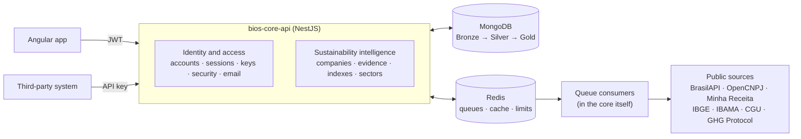

# bios-core-api

🇧🇷 [Português](README.md) · 🇺🇸 **English**

[](https://github.com/odavibatista/bios-core-api/actions/workflows/ci.yml)

API of **BIOS — Business Intelligence on Sustainability**. Starting from a CNPJ (Brazilian company tax
ID), it gathers public data from official sources, consolidates the company's environmental evidence and
calculates, for **SDGs 13 (Climate Action)** and **15 (Life on Land)**, an **adherence index** with a
**confidence level** and an **evidence-by-evidence explanation**.

> **Evidence First:** no index exists without evidence traceable to the original source. Missing data is
> not negative evidence, and the index is never a sustainability verdict.

**[📚 Full technical documentation →](docs/en/README.md)** · Requirements and modeling:
[bios-docs](https://github.com/odavibatista/bios-docs) (in Portuguese)

---

## What the API does

| Capability | How | Use cases |
| --- | --- | --- |
| **Company lookup** | Registration by CNPJ through a chain of three providers, with the official CNAE description (IBGE) | UC06 |
| **Environmental profile** | Evidence from IBAMA (infraction notices and embargoes), CGU (CEIS/CNEP) and the GHG Protocol, each with its reference to the source | UC07 |
| **Index and confidence per SDG** | Two separate numbers per SDG, recalculated through a queue, with each evidence's contribution | UC07, UC15 |
| **Search and ranking** | By name, state, municipality, CNAE, minimum index and confidence, sorted by the SDG's index | UC08 |
| **Export** | The filtered list as XLSX | UC09 |
| **Sector trends** | Average index per sector (CNAE division) month by month, always aggregated, never per company | UC10 |
| **Public API** | The same profile for third-party systems, through an API key with its own limit | UC11, UC12 |
| **Accounts and access** | Sign-up with email confirmation, revocable sessions, password recovery, roles and a domain blocklist | UC01–UC05, UC13, UC17 |

## Architecture

A modular monolith in **NestJS**, organized as Clean Architecture: each module has a domain (contracts
and schemas), HTTP (controllers) and infrastructure (repositories, adapters, use cases), and the modules
are gathered into two domain aggregators. Whoever asks for data and whoever collects it talk **only
through queues**: a consumer can become its own process without changing the contract.



- **Adapters per source:** each external source sits behind an interface, with a request limit, a
  maximum time and a log of every call, read from a catalog in the database.
- **Data layers:** `evidence_raw` (raw, per source) → `evidence_normalized` (normalized) →
  `company_profile` (ready for search, index and export).
- **Typed contract:** OpenAPI is generated from the same Zod schemas that validate the input and filter
  the output; every model has a name and every route a stable `operationId`, ready to generate the front
  end's client.

Details in [02. Architecture and conventions](docs/en/02-Architecture.md).

## Stack

| Layer | Technology |
| --- | --- |
| Runtime | Node.js ≥ 22.22.3, TypeScript 6 (`strict`), ESM |
| Framework | NestJS 12 |
| Database | MongoDB 8 (replica set) through Prisma ORM 6.19 |
| Validation and DTOs | Zod 4 with Nest's native Standard Schema |
| API documentation | `@nestjs/swagger` (OpenAPI generated from the Zod schemas) + Scalar |
| Queues, cache and rate limiting | Redis 7 through BullMQ 6, `ioredis` and `@nestjs/throttler` |
| Email | `nodemailer` over SMTP, Handlebars templates and auditing of every dispatch |
| Tests | Vitest 4, `@nestjs/testing`, Supertest and Faker |
| Quality | ESLint (type-checked), Prettier, Husky, commitlint and GitHub Actions |

Prisma stays on the 6 series because the 7 series does not support MongoDB yet.

## Quality

- **Over 3,100 unit tests and almost 1,000 e2e tests**, with line coverage above 99% (the required minimum
  is 75%). The e2e tests run against real MongoDB, Redis and queues, in parallel, with a database of their
  own per worker.
- **No real source in PR tests:** the external APIs are simulated by local HTTP servers, and a separate
  scheduled workflow checks the real sources' contract.
- **Automatic gates:** lint and affected tests on commit, type checking and the whole lint on push, the
  full suite in CI and a `develop` → `pre-prod` → `main` flow with branch protection.
- **Secure by default:** every route is private until declared public, personal data is encrypted
  (AES-256), keys and tokens are stored only as digests, and no data about individuals is collected
  (INL02).

## Quick start

```bash
npm install                 # dependencies and Prisma Client
cp .env.example .env        # environment variables
npm run keys:generate       # encryption keys (paste them into .env)
npm run docker:up           # MongoDB (replica set) and Redis
npm run db:push             # collections and indexes
npm run start:dev           # API at http://localhost:3000
```

| Address | Content |
| --- | --- |
| `GET /health` | Status of the API, the database and Redis |
| `/docs` | Interactive API reference (Scalar) |
| `/docs/openapi.json` | OpenAPI document |

New database, scripts and first administrator: [01. Getting started](docs/en/01-Getting-Started.md) and
[04. Database and initial load](docs/en/04-Database.md).

## Documentation

The technical documentation lives in [`docs/en/`](docs/en/README.md) (and in Portuguese in
[`docs/`](docs/README.md)), in 18 numbered chapters: from installation and architecture to each data
source, the index calculation, the tests and CI. Every page has, right below the title, the shortcut to the
same page in the other language.

---

Academic project for Software Engineering and Software Management and Quality (Computer Science, USJT).
