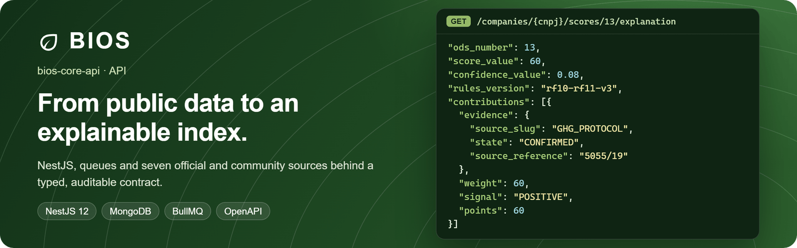
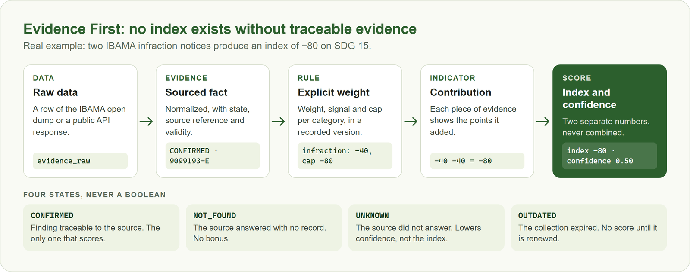
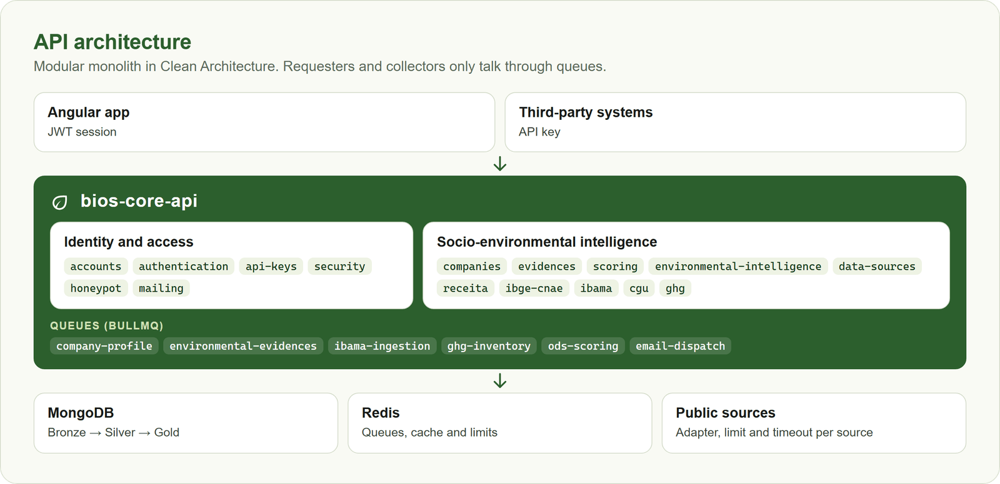
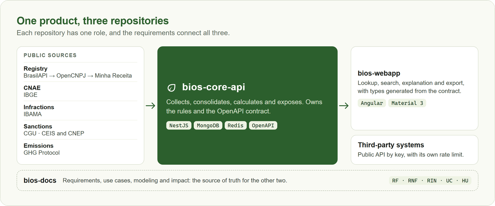

<p align="center">
  
</p>

<div align="center">

🇧🇷 [Português](README.md) · 🇺🇸 **English**

</div>

<p align="center">
  <a href="https://github.com/odavibatista/bios-core-api/actions/workflows/ci.yml"></a>
  
  
  
  
</p>

<p align="center">
  <a href="#what-the-api-does">What it does</a> ·
  <a href="#how-the-index-is-calculated">Index calculation</a> ·
  <a href="#architecture">Architecture</a> ·
  <a href="#engineering-decisions">Decisions</a> ·
  <a href="#quality">Quality</a> ·
  <a href="#quick-start">Quick start</a> ·
  <a href="#documentation">Documentation</a>
</p>

API of **BIOS — Business Intelligence on Sustainability**. Starting from a CNPJ (Brazilian company tax
ID), it gathers public data from official sources, consolidates the company's environmental evidence and
calculates, for **SDGs 13 (Climate Action)** and **15 (Life on Land)**, an **adherence index** with a
**confidence level** and an **evidence-by-evidence explanation**.

> **Evidence First:** no index exists without evidence traceable to the original source. Missing data is
> not negative evidence, and the index is never a sustainability verdict.

<p align="center">
  <a href="https://bios-webapp.vercel.app/"><strong>Open the demo</strong></a><br>
  <sub>The published interface uses real responses from this API, processed from official files. The API is not hosted.</sub>
</p>

**[📚 Full technical documentation →](docs/en/README.md)** · Requirements and modeling:
[bios-docs](https://github.com/odavibatista/bios-docs) (in Portuguese) · Interface:
[bios-webapp](https://github.com/odavibatista/bios-webapp)

## The problem

Environmental data about Brazilian companies is public, but scattered and in incompatible formats. IBAMA
publishes dumps with no lookup by CNPJ, with over 800 thousand rows and records of individuals mixed
with those of companies. CGU requires an API key. The GHG Protocol offers no stable REST contract. The federal
registry arrives through community mirrors. This API turns all of that into a single response that
is typed, explainable and traceable to its origin.

<p align="center">
  
</p>

## What the API does

| Capability | How | Use cases |
| --- | --- | --- |
| **Company lookup** | Registration by CNPJ through a chain of three providers, with the official CNAE description (IBGE) | UC06 |
| **Environmental profile** | Evidence from IBAMA (infraction notices and embargoes), CGU (CEIS/CNEP) and the GHG Protocol, each with its reference to the source | UC07 |
| **Index and confidence per SDG** | Two separate numbers per SDG, recalculated through a queue, with each evidence's contribution | UC07, UC15 |
| **Search and ranking** | By name, state, municipality, CNAE, minimum index and confidence, sorted by the SDG's index | UC08 |
| **Export** | The filtered list as XLSX | UC09 |
| **Sector trends** | Average index per sector (CNAE division) month by month, always aggregated, never per company | UC10 |
| **Movements** | Latest index change per SDG and company, with direction, cause and date, saved in the recalculation transaction without keeping the previous index; `GET /companies/movements` feeds the main screen | UC15, UC18 |
| **Public API** | The same profile for third-party systems, through an API key with its own limit | UC11, UC12 |
| **Accounts and access** | Sign-up with email confirmation, revocable sessions, password recovery, roles and a domain blocklist | UC01–UC05, UC13, UC17 |

## How the index is calculated

The index goes from −100 to 100, per SDG, with no overall index. Only `CONFIRMED`, current and traceable
evidence scores, and the sum of the contributions' points reproduces the index exactly:

| SDG | Evidence | Points | Cap | With reduced weight |
| --- | --- | --- | --- | --- |
| 13 | Emissions inventory in the GHG Protocol | +60 | +100 | — |
| 15 | Environmental infraction at IBAMA | −40 | −80 | −10 for a lifted embargo term |
| 15 | Sanction in CEIS or CNEP | −5 | −20 | −1.25 for an expired sanction |

Confidence is a separate number, between 0 and 1, and measures how much of the expected sources answered, and with what quality:

```math
C = \text{cap} \times \frac{S}{M} \times \frac{N}{N+1} \times \frac{1+Q}{2+Q} \times \frac{S}{S+U+O}
```

`N` is the number of contributions, `M` the sources expected for the SDG, `S` those that answered, `Q` the
quality of the findings, and `U` and `O` the sources with `UNKNOWN` and `OUTDATED`. The cap is 0.25 on SDG
13, due to its structurally low coverage, and 1 on SDG 15. Without contributions there is no index and
confidence is zero. Step by step in [14. SDG indexes](docs/en/14-SDG-Indexes.md).

## Architecture

<p align="center">
  
</p>

A modular monolith in **NestJS**, organized in Clean Architecture: each module has a domain (contracts and
schemas), HTTP (controllers) and infrastructure (repositories, adapters, use cases), and the modules are
gathered in two domain aggregators. Details in [02. Architecture and conventions](docs/en/02-Architecture.md).

- **Data layers:** `evidence_raw` (raw per source) → `evidence_normalized` (normalized) →
  `company_profile` (ready for search, index and export).
- **Per-source adapters:** each external source sits behind an interface, with a rate limit, a timeout and
  a log of every call read from a catalog in the database, changeable without a deploy.

## Engineering decisions

| Decision | Why |
| --- | --- |
| **The queue is the only coupling** | Requesters and collectors only share the job contract. A consumer can become its own process without touching the publisher. |
| **A source failure is a result, not an exception** | A source that is down comes back as `UNKNOWN`, with the reason. The lookup answers, and confidence drops instead of the index. |
| **One schema, three uses** | The same Zod schema validates input, drops undeclared output and generates the OpenAPI document. Documentation and behavior cannot diverge. |
| **Versioned rules** | Weights, signals and caps are explicit, and each index stores the rules version. An active SDG without a rule stops the calculation before any write. |
| **Privacy decided by the document** | The IBAMA dump has `PJ` rows with a CPF, so discarding individuals looks at the document, not the label. Partners and contacts never leave the adapter (INL02). |
| **Private by default** | A global guard protects every route until it declares itself public. Decoy routes with synthetic companies help identify unauthorized access. |
| **Secrets are not stored** | Personal data is encrypted with AES-256, and API keys and tokens are kept only as digests. Session renewal rotates the token and detects reuse. |
| **Limits per consumer** | Counters live in Redis, with custom storage on the same client as the cache: the limit applies per consumer, not per instance. |
| **Risk accepted in writing** | Prisma stays on the 6 series because the 7 series does not support MongoDB. The audit alert this keeps is assessed and recorded in the [tech sheet](https://github.com/odavibatista/bios-docs/blob/main/13-Ficha-Técnica.md). |

## Quality

| Measure | Result |
| --- | --- |
| Unit tests | **3,193** |
| E2e tests | **1,022**, against real MongoDB, Redis and queues, with a database per worker |
| Coverage | **99.71%** of lines and **93.97%** of branches (required minimum: 75%) |
| External sources | Local HTTP servers in PR tests, and a scheduled workflow checks the real sources' contract |
| Automatic gates | Lint and affected tests on commit, types and the whole lint on push, the full suite in CI and a `develop` → `pre-prod` → `main` flow with branch protection |

## Stack

| Layer | Technology |
| --- | --- |
| Runtime | Node.js ≥ 22.22.3, TypeScript 6 (`strict`), ESM |
| Framework | NestJS 12 |
| Database | MongoDB 8 (replica set) through Prisma ORM 6.19 |
| Validation and DTOs | Zod 4 with Nest's native Standard Schema |
| API documentation | `@nestjs/swagger` (OpenAPI generated from the Zod schemas) + Scalar |
| Queues, cache and rate limiting | Redis 7 through BullMQ 6, `ioredis` and `@nestjs/throttler` |
| Email | `nodemailer` over SMTP, Handlebars templates and auditing of every dispatch |
| Tests | Vitest 4, `@nestjs/testing`, Supertest and Faker |
| Quality | ESLint (type-checked), Prettier, Husky, commitlint and GitHub Actions |

## Quick start

```bash
npm install                 # dependencies and Prisma Client
cp .env.example .env        # environment variables
npm run keys:generate       # encryption keys (paste them into .env)
npm run docker:up           # MongoDB (replica set) and Redis
npm run db:push             # collections and indexes
npm run start:dev           # API at http://localhost:3000
```

| Address | Content |
| --- | --- |
| `GET /health` | Status of the API, the database and Redis |
| `/docs` | Interactive API reference (Scalar) |
| `/docs/openapi.json` | OpenAPI document |

New database, scripts and first administrator: [01. Getting started](docs/en/01-Getting-Started.md) and
[04. Database and initial load](docs/en/04-Database.md).

## Documentation

The technical documentation lives in [`docs/en/`](docs/en/README.md) (and in Portuguese in
[`docs/`](docs/README.md)), in 18 numbered chapters: from installation and architecture to each data
source, the index calculation, the tests and CI. Every page has, right below the title, the shortcut to the
same page in the other language.

## Ecosystem

<p align="center">
  
</p>

## Academic context

BIOS is the individual project of Assessment 3 of the Software Engineering and Software Management and
Quality courses, in the Computer Science program at Universidade São Judas Tadeu (USJT), Brazil, in 2026.

**Author:** Davi Deosmar Batista Oliveira Miranda · [GitHub](https://github.com/odavibatista) · [LinkedIn](https://www.linkedin.com/in/odavibatista/)

## License

© 2026 Davi Deosmar Batista Oliveira Miranda. All rights reserved. This repository is public for
reference and academic assessment; copying, modifying, distributing or using the material requires the
author's permission. See [LICENSE](LICENSE).
