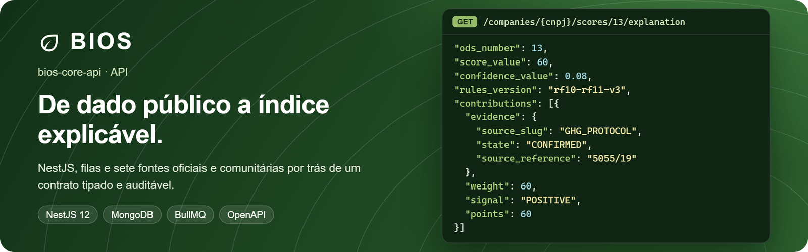
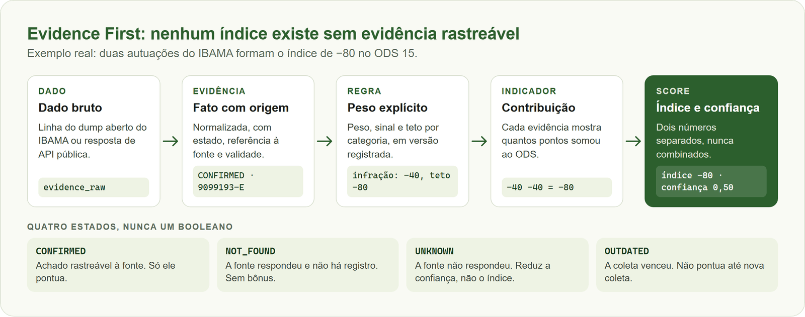
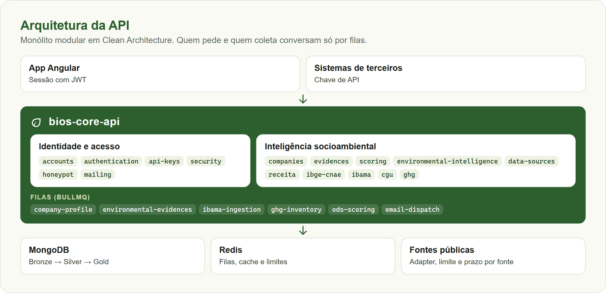
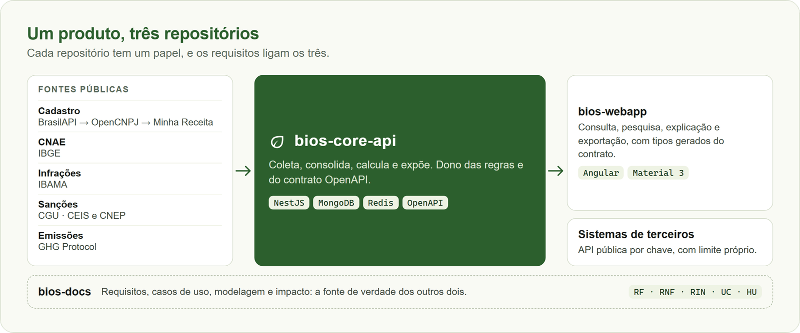

<p align="center">
  
</p>

<div align="center">

🇧🇷 **Português** · 🇺🇸 [English](README.en.md)

</div>

<p align="center">
  <a href="https://github.com/odavibatista/bios-core-api/actions/workflows/ci.yml"></a>
  
  
  
  
</p>

<p align="center">
  <a href="#o-que-a-api-faz">O que faz</a> ·
  <a href="#como-o-índice-é-calculado">Cálculo do índice</a> ·
  <a href="#arquitetura">Arquitetura</a> ·
  <a href="#decisões-de-engenharia">Decisões</a> ·
  <a href="#qualidade">Qualidade</a> ·
  <a href="#início-rápido">Início rápido</a> ·
  <a href="#documentação">Documentação</a>
</p>

API do **BIOS — Business Intelligence on Sustainability**. A partir de um CNPJ, ela reúne dados públicos
de fontes oficiais, consolida as evidências ambientais da empresa e calcula, para os **ODS 13 (Ação
Climática)** e **15 (Vida Terrestre)**, um **índice de aderência** com **nível de confiança** e
**explicação evidência a evidência**.

> **Evidence First:** nenhum índice existe sem evidência rastreável até a fonte original. Ausência de
> dado não é evidência negativa, e o índice nunca é um veredito de sustentabilidade.

<p align="center">
  <a href="https://bios-webapp.vercel.app/"><strong>Abrir a demonstração</strong></a><br>
  <sub>A interface publicada usa respostas reais desta API, processadas a partir de arquivos oficiais. A API não está hospedada.</sub>
</p>

**[📚 Documentação técnica completa →](docs/README.md)** · Requisitos e modelagem:
[bios-docs](https://github.com/odavibatista/bios-docs) · Interface:
[bios-webapp](https://github.com/odavibatista/bios-webapp)

## O problema

Os dados ambientais de empresas brasileiras são públicos, mas estão espalhados e em formatos
incompatíveis. O IBAMA publica dumps sem consulta por CNPJ, com mais de 800 mil linhas e registros de
pessoa física misturados aos de empresa. A CGU exige chave de API. O GHG Protocol não oferece
contrato REST estável. O cadastro da Receita chega por espelhos comunitários. Esta API transforma isso em uma
única resposta, tipada, explicável e rastreável até a origem.

<p align="center">
  
</p>

## O que a API faz

| Capacidade | Como | Casos de uso |
| --- | --- | --- |
| **Consulta de empresa** | Cadastro por CNPJ numa cadeia de três provedores, com descrição oficial do CNAE (IBGE) | UC06 |
| **Perfil ambiental** | Evidências do IBAMA (autuações e embargos), da CGU (CEIS/CNEP) e do GHG Protocol, cada uma com a referência à fonte | UC07 |
| **Índice e confiança por ODS** | Dois números separados por ODS, recalculados por fila, com a contribuição de cada evidência | UC07, UC15 |
| **Pesquisa e ranking** | Por nome, UF, município, CNAE, índice e confiança mínimos, ordenada pelo índice do ODS | UC08 |
| **Exportação** | A lista filtrada em XLSX | UC09 |
| **Evolução setorial** | Índice médio por setor (divisão CNAE) mês a mês, sempre agregado, nunca por empresa | UC10 |
| **Movimentações** | Última mudança do índice de cada ODS por empresa, com sentido, causa e data, gravada na transação do recálculo, sem guardar o índice anterior; `GET /companies/movements` alimenta a tela principal |
| **API pública** | O mesmo perfil para sistemas de terceiros, por chave de API com limite próprio | UC11, UC12 |
| **Contas e acesso** | Cadastro com confirmação por e-mail, sessões revogáveis, recuperação de senha, papéis e blacklist de domínios | UC01–UC05, UC13, UC17 |

## Como o índice é calculado

O índice vai de −100 a 100, por ODS, sem índice geral. Só evidência `CONFIRMED`, vigente e rastreável
pontua, e a soma dos pontos das contribuições reproduz exatamente o índice:

| ODS | Evidência | Pontos | Teto | Com peso reduzido |
| --- | --- | --- | --- | --- |
| 13 | Inventário de emissões no GHG Protocol | +60 | +100 | — |
| 15 | Infração ambiental no IBAMA | −40 | −80 | −10 por termo de embargo levantado |
| 15 | Sanção no CEIS ou CNEP | −5 | −20 | −1,25 por sanção vencida |

A confiança é um número separado, entre 0 e 1, e mede quanto das fontes esperadas respondeu e com que qualidade:

```math
C = \text{teto} \times \frac{S}{M} \times \frac{N}{N+1} \times \frac{1+Q}{2+Q} \times \frac{S}{S+U+O}
```

`N` é o número de contribuições, `M` as fontes esperadas para o ODS, `S` as que responderam, `Q` a
qualidade dos achados e `U` e `O` as fontes com `UNKNOWN` e `OUTDATED`. O teto é 0,25 no ODS 13, por sua
baixa cobertura estrutural, e 1 no ODS 15. Sem contribuição, não há índice e a confiança é zero. Passo a
passo em [14. Índices por ODS](docs/14-Índices-por-ODS.md).

## Arquitetura

<p align="center">
  
</p>

Um monólito modular em **NestJS**, organizado em Clean Architecture: cada módulo tem domínio (contratos e
schemas), HTTP (controllers) e infraestrutura (repositórios, adapters, casos de uso), e os módulos são
reunidos em dois agregadores de domínio. Detalhes em
[02. Arquitetura e convenções](docs/02-Arquitetura.md).

- **Camadas de dados:** `evidence_raw` (bruto por fonte) → `evidence_normalized` (normalizado) →
  `company_profile` (pronto para busca, índice e exportação).
- **Adapters por fonte:** cada fonte externa fica atrás de uma interface, com limite de requisições,
  tempo máximo e log de cada chamada lidos de um catálogo no banco, alteráveis sem deploy.

## Decisões de engenharia

| Decisão | Por quê |
| --- | --- |
| **A fila é o único acoplamento** | Quem pede e quem coleta só compartilham o contrato do job. Um consumidor pode virar processo próprio sem tocar em quem publica. |
| **Falha de fonte é resultado, não exceção** | Fonte fora do ar volta como `UNKNOWN`, com o motivo. A consulta responde, e a confiança cai em vez do índice. |
| **Um schema, três usos** | O mesmo schema Zod valida a entrada, descarta da saída o que não foi declarado e gera o OpenAPI. Documentação e comportamento não têm como divergir. |
| **Regras versionadas** | Pesos, sinais e tetos são explícitos, e cada índice guarda a versão das regras. Um ODS ativo sem regra interrompe o cálculo antes de qualquer escrita. |
| **Privacidade decidida pelo documento** | No dump do IBAMA há linhas `PJ` com CPF, então o descarte de pessoa física olha o documento, não o rótulo. Sócios e contatos das fontes não passam do adapter (INL02). |
| **Privada por padrão** | Um guard global protege toda rota até ela se declarar pública. Rotas isca com empresas sintéticas ajudam a identificar acesso não autorizado. |
| **Segredo não se guarda** | Dados pessoais são cifrados com AES-256, e chaves de API e tokens ficam só como resumo. A renovação de sessão rotaciona o token e detecta reuso. |
| **Limite por consumidor** | Os contadores ficam no Redis, com armazenamento próprio sobre o mesmo cliente do cache: o limite vale por consumidor, não por instância. |
| **Risco aceito por escrito** | O Prisma fica na série 6 porque a 7 não suporta MongoDB. O alerta da auditoria que isso mantém está avaliado e registrado na [ficha técnica](https://github.com/odavibatista/bios-docs/blob/main/13-Ficha-Técnica.md). |

## Qualidade

| Medida | Resultado |
| --- | --- |
| Testes unitários | **3.193** |
| Testes e2e | **1.022**, contra MongoDB, Redis e filas reais, com banco próprio por worker |
| Cobertura | **99,71%** das linhas e **93,97%** dos ramos (mínimo exigido: 75%) |
| Fontes externas | Servidores HTTP locais nos testes de PR, e um workflow agendado confere o contrato das fontes reais |
| Barreiras automáticas | Lint e testes afetados no commit, tipos e lint inteiro no push, suíte completa no CI e fluxo `develop` → `pre-prod` → `main` com proteção de branch |

## Stack

| Camada | Tecnologia |
| --- | --- |
| Runtime | Node.js ≥ 22.22.3, TypeScript 6 (`strict`), ESM |
| Framework | NestJS 12 |
| Banco de dados | MongoDB 8 (replica set) via Prisma ORM 6.19 |
| Validação e DTOs | Zod 4 com Standard Schema nativo do Nest |
| Documentação da API | `@nestjs/swagger` (OpenAPI gerado dos schemas Zod) + Scalar |
| Filas, cache e limite de requisições | Redis 7 via BullMQ 6, `ioredis` e `@nestjs/throttler` |
| E-mail | `nodemailer` por SMTP, templates Handlebars e auditoria de cada disparo |
| Testes | Vitest 4, `@nestjs/testing`, Supertest e Faker |
| Qualidade | ESLint (type-checked), Prettier, Husky, commitlint e GitHub Actions |

## Início rápido

```bash
npm install                 # dependências e Prisma Client
cp .env.example .env        # variáveis de ambiente
npm run keys:generate       # chaves de criptografia (cole no .env)
npm run docker:up           # MongoDB (replica set) e Redis
npm run db:push             # coleções e índices
npm run start:dev           # API em http://localhost:3000
```

| Endereço | Conteúdo |
| --- | --- |
| `GET /health` | Situação da API, do banco e do Redis |
| `/docs` | Referência interativa da API (Scalar) |
| `/docs/openapi.json` | Documento OpenAPI |

Banco novo, scripts e primeiro administrador: [01. Como rodar](docs/01-Como-Rodar.md) e
[04. Banco de dados e carga inicial](docs/04-Banco-de-Dados.md).

## Documentação

A documentação técnica fica em [`docs/`](docs/README.md) (e, em inglês, em [`docs/en/`](docs/en/README.md)),
em 18 capítulos numerados: da instalação e da arquitetura até cada fonte de dados, o cálculo dos índices, os
testes e o CI. Cada página tem, logo abaixo do título, o atalho para a mesma página no outro idioma.

## Ecossistema

<p align="center">
  
</p>

## Contexto acadêmico

O BIOS é o projeto individual da Avaliação 3 das disciplinas de Engenharia de Software e de Gestão e
Qualidade de Software, do curso de Ciência da Computação da Universidade São Judas Tadeu (USJT), em
2026.

**Autor:** Davi Deosmar Batista Oliveira Miranda · [GitHub](https://github.com/odavibatista) · [LinkedIn](https://www.linkedin.com/in/odavibatista/)

## Licença

© 2026 Davi Deosmar Batista Oliveira Miranda. Todos os direitos reservados. Este repositório é
público para consulta e avaliação acadêmica; copiar, modificar, distribuir ou usar o material depende
de autorização do autor. Veja [LICENSE](LICENSE).
