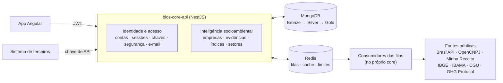

# bios-core-api

[](https://github.com/odavibatista/bios-core-api/actions/workflows/ci.yml)

API do **BIOS — Business Intelligence on Sustainability**. A partir de um CNPJ, ela reúne dados públicos de
fontes oficiais, consolida as evidências ambientais da empresa e calcula, para os **ODS 13 (Ação Climática)**
e **15 (Vida Terrestre)**, um **índice de aderência** com **nível de confiança** e **explicação evidência a
evidência**.

> **Evidence First:** nenhum índice existe sem evidência rastreável até a fonte original. Ausência de dado
> não é evidência negativa, e o índice nunca é um veredito de sustentabilidade.

**[📚 Documentação técnica completa →](docs/README.md)** · Requisitos e modelagem:
[bios-docs](https://github.com/odavibatista/bios-docs)

---

## O que a API faz

| Capacidade | Como | Casos de uso |
| --- | --- | --- |
| **Consulta de empresa** | Cadastro por CNPJ numa cadeia de três provedores, com descrição oficial do CNAE (IBGE) | UC06 |
| **Perfil ambiental** | Evidências do IBAMA (autuações e embargos), da CGU (CEIS/CNEP) e do GHG Protocol, cada uma com a referência à fonte | UC07 |
| **Índice e confiança por ODS** | Dois números separados por ODS, recalculados por fila, com a contribuição de cada evidência | UC07, UC15 |
| **Pesquisa e ranking** | Por nome, UF, município, CNAE, índice e confiança mínimos, ordenada pelo índice do ODS | UC08 |
| **Exportação** | A lista filtrada em XLSX | UC09 |
| **Evolução setorial** | Índice médio por setor (divisão CNAE) mês a mês, sempre agregado, nunca por empresa | UC10 |
| **API pública** | O mesmo perfil para sistemas de terceiros, por chave de API com limite próprio | UC11, UC12 |
| **Contas e acesso** | Cadastro com confirmação por e-mail, sessões revogáveis, recuperação de senha, papéis e blacklist de domínios | UC01–UC05, UC13, UC17 |

## Arquitetura

Um monólito modular em **NestJS**, organizado em Clean Architecture: cada módulo tem domínio (contratos e
schemas), HTTP (controllers) e infraestrutura (repositórios, adapters, casos de uso), e os módulos são
reunidos em dois agregadores de domínio. Quem pede um dado e quem o coleta conversam **só por filas**: um
consumidor pode virar processo próprio sem mudar o contrato.



- **Adapters por fonte:** cada fonte externa fica atrás de uma interface, com limite de requisições,
  tempo máximo e log de cada chamada lidos de um catálogo no banco.
- **Camadas de dados:** `evidence_raw` (bruto por fonte) → `evidence_normalized` (normalizado) →
  `company_profile` (pronto para busca, índice e exportação).
- **Contrato tipado:** o OpenAPI é gerado dos mesmos schemas Zod que validam a entrada e filtram a saída;
  todo modelo tem nome e toda rota tem `operationId` estável, prontos para gerar o cliente do front.

Detalhes em [02. Arquitetura e convenções](docs/02-Arquitetura.md).

## Stack

| Camada | Tecnologia |
| --- | --- |
| Runtime | Node.js ≥ 22.22.3, TypeScript 6 (`strict`), ESM |
| Framework | NestJS 12 |
| Banco de dados | MongoDB 8 (replica set) via Prisma ORM 6.19 |
| Validação e DTOs | Zod 4 com Standard Schema nativo do Nest |
| Documentação da API | `@nestjs/swagger` (OpenAPI gerado dos schemas Zod) + Scalar |
| Filas, cache e limite de requisições | Redis 7 via BullMQ 6, `ioredis` e `@nestjs/throttler` |
| E-mail | `nodemailer` por SMTP, templates Handlebars e auditoria de cada disparo |
| Testes | Vitest 4, `@nestjs/testing`, Supertest e Faker |
| Qualidade | ESLint (type-checked), Prettier, Husky, commitlint e GitHub Actions |

O Prisma fica na série 6 porque a série 7 ainda não suporta MongoDB.

## Qualidade

- **Mais de 3 100 testes unitários e quase 1 000 testes e2e**, com cobertura de linhas acima de 99% (o
  mínimo exigido é 75%). Os e2e rodam contra MongoDB, Redis e filas reais, em paralelo, com banco próprio
  por worker.
- **Nenhuma fonte real nos testes de PR:** as APIs externas são simuladas por servidores HTTP locais, e um
  workflow agendado à parte confere o contrato das fontes reais.
- **Barreiras automáticas:** lint e testes afetados no commit, verificação de tipos e lint inteiro no push,
  suíte completa no CI e fluxo `develop` → `pre-prod` → `main` com proteção de branch.
- **Segurança por padrão:** toda rota é privada até ser declarada pública, dados pessoais são cifrados
  (AES-256), chaves e tokens são guardados só como resumo, e nenhum dado de pessoa física é coletado
  (INL02).

## Início rápido

```bash
npm install                 # dependências e Prisma Client
cp .env.example .env        # variáveis de ambiente
npm run keys:generate       # chaves de criptografia (cole no .env)
npm run docker:up           # MongoDB (replica set) e Redis
npm run db:push             # coleções e índices
npm run start:dev           # API em http://localhost:3000
```

| Endereço | Conteúdo |
| --- | --- |
| `GET /health` | Situação da API, do banco e do Redis |
| `/docs` | Referência interativa da API (Scalar) |
| `/docs/openapi.json` | Documento OpenAPI |

Banco novo, scripts e primeiro administrador: [01. Como rodar](docs/01-Como-Rodar.md) e
[04. Banco de dados e carga inicial](docs/04-Banco-de-Dados.md).

## Documentação

A documentação técnica fica em [`docs/`](docs/README.md), em 18 capítulos numerados: da instalação e da
arquitetura até cada fonte de dados, o cálculo dos índices, os testes e o CI.

---

Projeto acadêmico de Engenharia de Software e Gestão e Qualidade de Software (Ciência da Computação, USJT).
